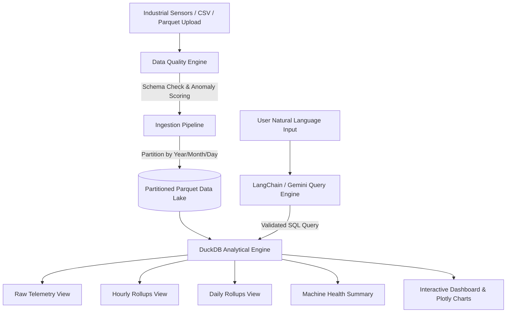

# Industrial Sensor Data Lake & Analytics Pipeline

[](https://www.python.org/)
[](https://duckdb.org/)
[](https://parquet.apache.org/)
[](https://www.langchain.com/)
[](https://streamlit.io/)

An end-to-end industrial IoT sensor data pipeline for incremental ingestion, automated data-quality validation, transformation, partitioned Parquet data lake storage, DuckDB SQL analytics rollups, and a LangChain natural-language AI query interface.

---

## 🌟 Key Highlights

- **Incremental Ingestion & Quality Audit**: Validates schema compliance, detects out-of-range sensor anomalies, flags missing values, and checks timestamp continuity with automated quality scoring.
- **Partitioned Parquet Storage**: Stores sensor telemetry in `year=YYYY/month=MM/day=DD` Hive-partitioned columnar Parquet files using **PyArrow** and **Pandas**.
- **DuckDB Analytical Layer**: High-performance SQL analytics directly over Parquet files, featuring automated **Hourly Rollups** (`hourly_sensor_rollups`) and **Daily Rollups** (`daily_sensor_rollups`).
- **LangChain Natural-Language Query Engine**: Converts complex user questions (e.g., *"from jan to feb till 10pm what was the flow"*) into validated DuckDB SQL queries, returning text explanations, metric cards, and responsive Plotly charts.
- **Interactive Full-Stack Web UI**: Built with Streamlit, dark industrial styling, real-time KPI metrics, data uploader, interactive AI query assistant, and direct DuckDB SQL workbench.

---

## 🏗️ Architecture Overview



---

## 📁 Repository Structure

```
Industrial-Sensor-Data-Lake-Analytics-Pipeline/
├── app.py                     # Main Streamlit Web Application UI
├── sample_data_generator.py    # Synthetic Industrial Sensor Telemetry Generator
├── requirements.txt            # Python Dependencies
├── README.md                   # Project Documentation
├── data_pipeline/
│   ├── __init__.py
│   ├── quality.py              # Data Quality & Anomaly Audit Engine
│   ├── storage.py              # Hive Partitioned Parquet Lake Writer
│   └── ingestion.py            # Pipeline Coordinator
├── analytics/
│   ├── __init__.py
│   └── duckdb_engine.py        # DuckDB Analytical Views & Rollup Engine
└── query_engine/
    ├── __init__.py
    └── nl_to_sql.py            # LangChain & Hybrid NL-to-SQL Query Translator
```

---

## ⚡ Quickstart & Installation

### 1. Clone & Set Up Environment

```bash
git clone https://github.com/B-LIPIKA/Industrial-Sensor-Data-Lake-Analytics-Pipeline.git
cd Industrial-Sensor-Data-Lake-Analytics-Pipeline

# Create virtual environment
python -m venv .venv
source .venv/bin/activate  # On Windows: .venv\Scripts\activate

# Install requirements
pip install -r requirements.txt
```

### 2. Run the Web Application

```bash
streamlit run app.py
```

Open your browser at `http://localhost:8501`.

---

## 💬 Natural Language Query Capabilities

The query interface converts complex temporal questions into validated DuckDB SQL:

| User Natural Language Query | Generated DuckDB SQL Pattern | Visual Output |
|---|---|---|
| *"from jan to feb till 10pm what was the flow"* | `SELECT date, hour, AVG(avg_value), SUM(total_sum_value) FROM hourly_sensor_rollups WHERE sensor_type='flow_rate' AND date >= '2026-01-01' AND date <= '2026-02-28' AND hour <= 22 GROUP BY date, hour` | Time-Series Line Chart + Volume Metric Card |
| *"What was the max temperature on PUMP-01 in February?"* | `SELECT date, MAX(max_value) FROM daily_sensor_rollups WHERE machine_id='PUMP-01' AND sensor_type='temperature' AND date >= '2026-02-01' AND date <= '2026-02-28'` | Max Temperature KPI Card |
| *"Show hourly power consumption trend for TURBINE-03"* | `SELECT date, hour, avg_value FROM hourly_sensor_rollups WHERE machine_id='TURBINE-03' AND sensor_type='power_consumption'` | Hourly Trend Chart |
| *"Find top 10 vibration anomalies across all machines"* | `SELECT timestamp, machine_id, sensor_id, value, status FROM raw_sensor_data WHERE sensor_type='vibration' AND status IN ('WARNING', 'CRITICAL') ORDER BY value DESC LIMIT 10` | Anomaly Data Table |

---

## 🛠️ Technology Stack

- **Data Processing & Analytics**: Python 3.10+, DuckDB, Pandas, PyArrow, NumPy
- **Storage**: Apache Parquet (Hive Partitioning: `year=YYYY/month=MM/day=DD`)
- **AI & NLP**: LangChain, Google Gemini API (`google-genai`), Regex Fallback Parser
- **Visualization & UI**: Streamlit, Plotly Express
